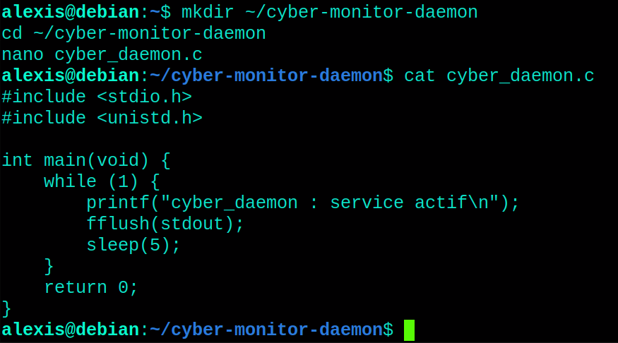
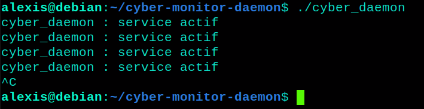
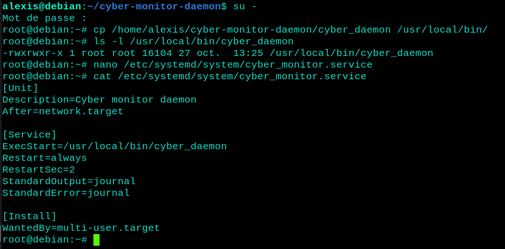
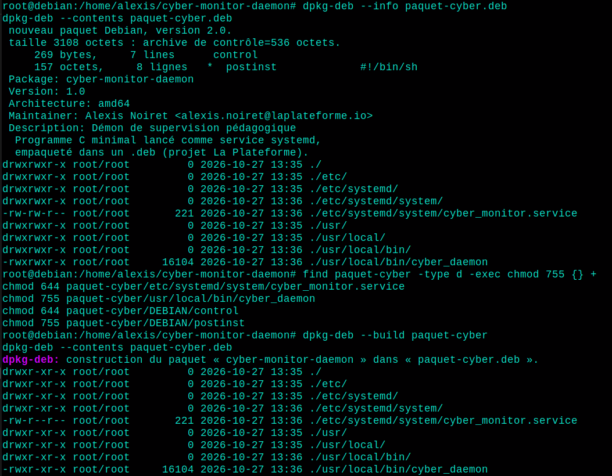

# 🛡️ cyber-monitor-daemon - Compilation, persistance et packaging sous Linux


> Compiler un démon en C avec GCC, le rendre persistant avec un service systemd, puis l'empaqueter dans un `.deb` : lecture supply chain (MITRE ATT&CK T1543.002).

Projet réalisé dans le cadre du **Bachelor IT Cybersécurité** - La Plateforme, par **Alexis Noiret**.

Le sujet comporte trois jobs et une étape de test. Tout a été réalisé **à la main** sur une VM Debian ; ce dépôt contient les fichiers du projet, la documentation de chaque job (commandes, captures, réponses aux questions) et un compte rendu PDF par job.

---

## 🖥️ Environnement

| Élément | Valeur |
|---|---|
| Système | Debian 13 (trixie), architecture `amd64` |
| Compilateur | GCC 14.2.0 (Debian 14.2.0-19) |
| Persistance | systemd (`systemctl`, `journalctl`) |
| Packaging | `dpkg-deb` |
| Droits | `su -` pour les opérations root (`sudo` n'est pas installé par défaut sur Debian) |

---

## 📋 Sommaire

- [Préparation de la machine](#-préparation-de-la-machine)
- [Job 1 - La chaîne de compilation GCC](#job-1---la-chaîne-de-compilation-gcc)
- [Job 2 - Persistance via un service systemd](#job-2---persistance-via-un-service-systemd)
- [Job 3 - Industrialisation et supply chain : le paquet Debian](#job-3---industrialisation-et-supply-chain--le-paquet-debian)
- [Étape 4 - Scénario de test et validation générale](#étape-4---scénario-de-test-et-validation-générale)
- [Lecture supply chain](#-lecture-supply-chain)
- [Structure du dépôt](#-structure-du-dépôt)

---

## 🔧 Préparation de la machine

Sur une Debian fraîchement installée, GCC et `sudo` sont absents. Les opérations root se font avec `su -`.

```bash
su -
apt install build-essential
exit
```

### Problèmes rencontrés

- **`sudo : commande introuvable`** : `sudo` n'est pas installé par défaut sur Debian. Solution : passer root avec `su -`.
- **`apt` réclamait le DVD d'installation** : la source « cdrom » était restée dans `/etc/apt/sources.list`. Solution : la désactiver en la commentant, sans la supprimer.

```bash
sed -i '1s/^/# /' /etc/apt/sources.list
apt update
```

---

## Job 1 - La chaîne de compilation GCC

> **Consigne** : Écrire un programme `cyber_daemon.c` minimaliste qui tourne indéfiniment, affiche un message toutes les 5 secondes et force l'écriture immédiate de sa sortie. Le compiler en quatre étapes (préprocesseur, assembleur, fichier objet, édition de liens) et expliquer ce que fait chaque étape.

### Le programme

```c
#include <stdio.h>
#include <unistd.h>

int main(void) {
    while (1) {
        printf("cyber_daemon : service actif\n");
        fflush(stdout);
        sleep(5);
    }
    return 0;
}
```



- `while (1)` : boucle infinie.
- `printf` affiche le message, `sleep(5)` fait une pause de 5 secondes.
- `fflush(stdout)` vide le tampon de sortie. Sans lui, une sortie redirigée vers le journal (cas de systemd au Job 2) resterait en mémoire tampon et n'apparaîtrait pas dans les logs.

### Étape 1 - Le préprocesseur (`-E`)

```bash
gcc -E cyber_daemon.c -o cyber_daemon.i
wc -l cyber_daemon.i
tail -n 15 cyber_daemon.i
```


**Que s'est-il passé avec les `#include` ?** Le préprocesseur a remplacé chaque `#include` par le **contenu complet de l'en-tête** correspondant (`stdio.h`, `unistd.h` et les en-têtes qu'ils incluent). Le fichier est passé de 11 à **2085 lignes**, surtout des déclarations (types, prototypes de `printf`, `fflush`, `sleep`). Le code écrit est inchangé, en fin de fichier. Les lignes `# 4 "cyber_daemon.c"` sont des repères ajoutés par GCC (fichier et ligne d'origine), pas du code.

### Étape 2 - La traduction en assembleur (`-S`)

```bash
gcc -S cyber_daemon.i -o cyber_daemon.s
cat cyber_daemon.s
```


**Reste-t-il une trace du langage C ?** Non : plus de `while`, de `;` ni d'accolades. Ce sont des instructions processeur lisibles (`pushq`, `movq`, `leaq`, `call`, `jmp`) et des directives de l'assembleur (lignes commençant par un point).

| Élément | Rôle |
|---|---|
| `.LC0` / `.string` | Le texte du message, en zone de données en lecture seule (`.rodata`) |
| `call puts@PLT` | GCC a remplacé `printf` par `puts` : le texte est fixe et se termine par un retour à la ligne |
| `call fflush@PLT`, `call sleep@PLT` | Les deux autres appels (avec `5` placé dans `%edi` pour `sleep`) |
| `jmp .L2` | Saut inconditionnel vers le début de la boucle : l'équivalent de `while (1)` |

### Étape 3 - Le fichier objet (`-c`)

```bash
gcc -c cyber_daemon.s -o cyber_daemon.o
cat cyber_daemon.o
file cyber_daemon.o
nm cyber_daemon.o
```


**Pourquoi ce fichier n'est-il pas exécutable alors qu'il est en binaire ?**

- `cat` affiche du charabia : c'est du code machine, pas du texte.
- `file` indique `ELF 64-bit LSB relocatable` : le fichier est destiné à être assemblé avec d'autres morceaux, pas lancé seul.
- `nm` montre les symboles non résolus :

| Symbole | Signification |
|---|---|
| `T main` | défini dans ce fichier |
| `U puts`, `U fflush`, `U sleep`, `U stdout` | **non résolus** (*undefined*) : leur code se trouve dans la libc |

Le `.o` appelle des fonctions dont il n'a pas le code, et il n'a pas non plus le code de démarrage qui appelle `main`.

### Étape 4 - L'édition de liens

```bash
gcc cyber_daemon.o -o cyber_daemon
file cyber_daemon
ls -l cyber_daemon.o cyber_daemon
./cyber_daemon
```




**Qu'est-ce que l'édition de liens a ajouté ?** Le fichier passe de **1576 octets** (`.o`) à **16104 octets**, et `file` indique désormais `pie executable, dynamically linked` :

- le **code de démarrage** (`_start`, fourni par `crt1.o`), qui prépare le programme puis appelle `main` ;
- les **mécanismes de liaison avec la libc** (tables GOT et PLT, interpréteur `/lib64/ld-linux-x86-64.so.2`) pour résoudre `puts`, `fflush` et `sleep` au lancement ;
- l'**en-tête d'exécutable** et la mise en page finale (adresses, sections).

Le symbole `U fflush@GLIBC_2.2.5` reste marqué `U` : c'est normal, la fonction est fournie dynamiquement par la libc à l'exécution.

### À retenir

- Compiler, c'est quatre transformations : `.c` → `.i` → `.s` → `.o` → exécutable.
- Un fichier objet est du binaire **incomplet** : il lui manque les fonctions externes et le code de démarrage.
- `fflush(stdout)` est indispensable pour qu'un service systemd récupère ses messages.

Compte rendu détaillé : [docs/Job1_Compilation_GCC.pdf](docs/Job1_Compilation_GCC.pdf)

---

## Job 2 - Persistance via un service systemd

> **Consigne** : Copier le binaire dans `/usr/local/bin/` et créer un service systemd qui le relance automatiquement au boot. Trouver la commande `journalctl` qui permet de suivre en direct les logs de ce seul service.

### Copie du binaire et fichier d'unité

```bash
su -
cp /home/alexis/cyber-monitor-daemon/cyber_daemon /usr/local/bin/
ls -l /usr/local/bin/cyber_daemon
nano /etc/systemd/system/cyber_monitor.service
```

```ini
[Unit]
Description=Cyber monitor daemon
After=network.target

[Service]
ExecStart=/usr/local/bin/cyber_daemon
Restart=always
RestartSec=2
StandardOutput=journal
StandardError=journal

[Install]
WantedBy=multi-user.target
```



| Section | Directive | Rôle |
|---|---|---|
| `[Unit]` | `Description=` | Nom lisible du service |
| `[Unit]` | `After=network.target` | Démarre après que le réseau est prêt |
| `[Service]` | `ExecStart=` | Chemin absolu du binaire |
| `[Service]` | `Restart=always` | Relance le programme dès qu'il s'arrête : **c'est la persistance** |
| `[Service]` | `RestartSec=2` | Attend 2 secondes avant de relancer |
| `[Service]` | `StandardOutput=journal`, `StandardError=journal` | Sortie redirigée vers le journal système |
| `[Install]` | `WantedBy=multi-user.target` | Démarrage automatique au boot (utilisé par `enable`) |

### Chargement, activation et démarrage

```bash
systemctl daemon-reload
systemctl enable --now cyber_monitor.service
systemctl status cyber_monitor.service
```


- `daemon-reload` demande à systemd de relire les fichiers d'unité.
- `enable` crée le lien dans `multi-user.target.wants/` (démarrage au boot) ; `--now` démarre aussi le service immédiatement.

### Détection côté SOC et test de persistance

> **Réflexion cyber** : comment un analyste SOC détecte-t-il cette activité ?

```bash
journalctl -u cyber_monitor.service -f
```

`-u` filtre sur l'unité, `-f` suit les logs en direct. Un analyste peut aussi rechercher les unités récemment créées dans `/etc/systemd/system/` et lister les services activés avec `systemctl list-unit-files --state=enabled`.

Test de persistance : le processus est tué de force, systemd le relance.

```bash
systemctl show -p MainPID cyber_monitor.service
kill -9 $(systemctl show -p MainPID --value cyber_monitor.service)
sleep 4
systemctl show -p MainPID cyber_monitor.service
```


### À retenir

- `Restart=always` : le service revient après un crash ou un `kill -9`, et revient au boot grâce à `enable`.
- `journalctl -u <unité> -f` est la commande de base pour surveiller un service.
- Le message du programme apparaît dans le journal toutes les 5 secondes, ce qui confirme que `fflush` fait son travail.

Compte rendu détaillé : [docs/Job2_Persistance_Systemd.pdf](docs/Job2_Persistance_Systemd.pdf)

---

## Job 3 - Industrialisation et supply chain : le paquet Debian

> **Consigne** : Empaqueter le binaire et le service dans un `.deb`. Un paquet Debian exécute automatiquement un script `postinst` en root à l'installation : c'est exactement le vecteur d'une attaque supply chain.

### Arborescence du paquet

Les fichiers sont placés à leur **chemin final** dans le dossier du paquet ; `DEBIAN/` contient les métadonnées et les scripts.

```bash
mkdir -p paquet-cyber/DEBIAN
mkdir -p paquet-cyber/usr/local/bin
mkdir -p paquet-cyber/etc/systemd/system
cp /usr/local/bin/cyber_daemon paquet-cyber/usr/local/bin/
cp /etc/systemd/system/cyber_monitor.service paquet-cyber/etc/systemd/system/
find paquet-cyber
dpkg --print-architecture
```

### Fichier `DEBIAN/control`

```
Package: cyber-monitor-daemon
Version: 1.0
Architecture: amd64
Maintainer: Alexis Noiret <alexis.noiret@laplateforme.io>
Description: Démon de supervision pédagogique
 Programme C minimal lancé comme service systemd,
 empaqueté dans un .deb (projet La Plateforme).
```


- `Package` : nom en minuscules, sans underscore.
- `Architecture` : `amd64`, confirmée par `dpkg --print-architecture` (le binaire est compilé pour x86-64).
- `Description` : la première ligne est un résumé ; les lignes suivantes **commencent par un espace**, ce qui les rattache au champ.

### Script `DEBIAN/postinst`

```sh
#!/bin/sh
set -e

systemctl daemon-reload
systemctl enable --now cyber_monitor.service

echo "cyber-monitor-daemon installé : le service est actif."
exit 0
```

```bash
chmod 755 paquet-cyber/DEBIAN/postinst
ls -l paquet-cyber/DEBIAN/
dpkg-deb --build paquet-cyber
```


- `set -e` : le script s'arrête dès qu'une commande échoue, pour qu'un échec soit visible.
- `daemon-reload` puis `enable --now` : le service est activé et démarré sans aucune action de l'utilisateur.
- `chmod 755` est indispensable : sans droit d'exécution sur le `postinst`, la construction du paquet échoue.

### Inspection et correction des droits

```bash
dpkg-deb --info paquet-cyber.deb
dpkg-deb --contents paquet-cyber.deb
```



### Problèmes rencontrés

- **Droits trop larges dans le paquet** : la première construction contenait des dossiers en `775` et le fichier de service en `664` (modifiables par le groupe), car les dossiers avaient été créés en root avec un umask permissif. Ces droits auraient été appliqués sur la machine cible. Correction avant de reconstruire :

```bash
find paquet-cyber -type d -exec chmod 755 {} +
chmod 644 paquet-cyber/etc/systemd/system/cyber_monitor.service
chmod 755 paquet-cyber/usr/local/bin/cyber_daemon
chmod 644 paquet-cyber/DEBIAN/control
chmod 755 paquet-cyber/DEBIAN/postinst
dpkg-deb --build paquet-cyber
```

- **Fichiers créés en root dans le dossier personnel** : pour éviter des problèmes de droits avec Git lancé en utilisateur normal. Correction : `chown -R alexis:alexis /home/alexis/cyber-monitor-daemon`.

### À retenir

- Un `.deb` contient des fichiers **et** des scripts exécutés en root à l'installation.
- On inspecte un paquet **avant** de l'installer : `dpkg-deb --info` (métadonnées et scripts) et `--contents` (fichiers et chemins).
- Un paquet ne doit pas rendre un fichier système modifiable plus largement que nécessaire (dossiers en 755, fichiers de configuration en 644).

Compte rendu détaillé : [docs/Job3_Paquet_Debian.pdf](docs/Job3_Paquet_Debian.pdf)

---

## Étape 4 - Scénario de test et validation générale

> **Consigne** : Remettre la machine dans l'état initial (désactiver et supprimer manuellement le service et le binaire), puis installer le paquet et vérifier que le service démarre tout seul, sans action manuelle.

### Remise à zéro

```bash
systemctl disable --now cyber_monitor.service
rm /usr/local/bin/cyber_daemon
rm /etc/systemd/system/cyber_monitor.service
systemctl daemon-reload
ls /usr/local/bin/cyber_daemon
systemctl status cyber_monitor.service
```

Résultat attendu : `Aucun fichier ou dossier de ce nom` et `Unit cyber_monitor.service could not be found.`

### Installation et vérification

```bash
dpkg -i paquet-cyber.deb
systemctl status cyber_monitor.service
journalctl -u cyber_monitor.service -n 5
```


- `dpkg -i` dépaquette les fichiers, puis le `postinst` crée le lien `multi-user.target.wants/` et affiche le message de confirmation.
- Le service est `enabled` et `active (running)` avec un **nouveau PID (2091)**, et le message `cyber_daemon : service actif` apparaît toutes les 5 secondes dans le journal.
- Les lignes du journal sont affichées deux fois : `systemctl status` affiche déjà les dernières lignes du journal, que `journalctl -n 5` réaffiche ensuite.

**Aucune action manuelle n'a été nécessaire** : l'installation du paquet a suffi.

---

## 🔒 Lecture supply chain

Cette mécanique correspond à la technique **MITRE ATT&CK T1543.002** (*Create or Modify System Process: Systemd Service*) : en une seule commande, un programme s'est installé, activé et lancé en root, avec une persistance au démarrage, sans confirmation de l'utilisateur. Un paquet piégé fonctionne de la même façon : le `postinst` exécute ce que son auteur a voulu, avec tous les droits.

| Risque | Piste de défense |
|---|---|
| Paquet piégé installé avec ses scripts en root | N'installer que des paquets venant de dépôts de confiance, dont l'intégrité est vérifiée par signature |
| Script d'installation malveillant dans un `.deb` inconnu | Inspecter avant d'installer : `dpkg-deb --info`, `dpkg-deb --contents`, lecture des scripts |
| Service de persistance créé discrètement | Superviser `/etc/systemd/system/`, lister les unités activées (`systemctl list-unit-files --state=enabled`), suivre les logs avec `journalctl -u` |
| Droits trop larges sur les fichiers installés | Dossiers en 755, fichiers de configuration en 644, contrôle avec `dpkg-deb --contents` |

---

## ⚠️ Limites assumées

- Le paquet ne contient **pas de script `prerm`** : `dpkg -r cyber-monitor-daemon` supprime les fichiers sans arrêter ni désactiver le service. Il faut d'abord faire `systemctl disable --now cyber_monitor.service`.
- Le paquet n'est **pas signé** : l'intégrité n'est pas vérifiable par un dépôt, ce qui est précisément le point faible illustré par le sujet.
- Le programme est volontairement minimal : il n'écrit qu'un message toutes les 5 secondes et ne fait aucune supervision réelle.
- Testé uniquement sur Debian 13 (`amd64`).

---

## 📁 Structure du dépôt

```
cyber-monitor-daemon/
├── README.md
├── cyber_daemon.c               # code source du démon
├── cyber_daemon.i / .s / .o     # sorties des étapes de compilation
├── cyber_daemon                 # binaire final
├── cyber_monitor.service        # fichier d'unité systemd
├── paquet-cyber/                # arborescence du paquet
│   ├── DEBIAN/
│   │   ├── control
│   │   └── postinst
│   ├── etc/systemd/system/cyber_monitor.service
│   └── usr/local/bin/cyber_daemon
├── paquet-cyber.deb             # paquet construit
└── docs/
    ├── Job1_Compilation_GCC.pdf
    ├── Job2_Persistance_Systemd.pdf
    ├── Job3_Paquet_Debian.pdf
    └── images/                  # captures d'écran
```

---

## 🧠 Compétences démontrées

- **Administrer et sécuriser les infrastructures systèmes** : installation de la chaîne de compilation sur Debian, déploiement d'un binaire et d'un service systemd, droits de fichiers maîtrisés.
- **Appliquer les bonnes pratiques d'administration** : binaire dans `/usr/local/bin`, unité dans `/etc/systemd/system`, droits standards (755 / 644), paquet structuré selon les conventions Debian.
- **Mettre en production des évolutions de l'infrastructure** : passage d'un déploiement manuel à un paquet `.deb` installable en une commande, avec test de bout en bout après remise à zéro.
- **Mettre en œuvre et optimiser la supervision** : redirection de la sortie vers le journal système, suivi en direct avec `journalctl -u`, `fflush` pour que les logs arrivent immédiatement.
- **Participer à la détection et au traitement des incidents de sécurité** : détection d'une persistance systemd par un analyste SOC, test de résilience (`kill -9`) et lecture MITRE ATT&CK T1543.002.
- **Participer à la mesure et à l'analyse du niveau de sécurité** : analyse du vecteur supply chain d'un `postinst` exécuté en root, inspection d'un paquet avant installation, détection et correction de droits trop larges.

---

## 👤 Auteur

**Alexis Noiret** — Bachelor IT Cybersécurité, La Plateforme

- Portfolio : [alexis-noiret.students-laplateforme.io](https://alexis-noiret.students-laplateforme.io)
- GitHub : [github.com/alexis-noiret](https://github.com/alexis-noiret)
